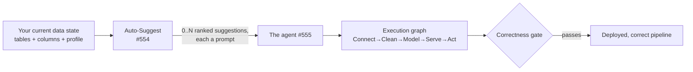

# Auto-Suggest — from your data to the use cases worth doing

Auto-Suggest ([#554](https://github.com/oramasearch/zetta/issues/554), FEAT-11) is a
**separate model** from the pipeline-building agent (#555). It studies a customer's
**current data state** and returns **zero-to-many** use cases — ranked, personalized —
each expressed as a **prompt** that can be handed to the agent to produce an
execution-graph game. It takes the guesswork out of *"what should I even do with my
data?"*.

It is the **"what"** in the Personalized Intelligence trio:

| | model | question it answers |
|---|---|---|
| **Auto-Suggest** (#554) | *this* | **what** should you build, given your data? |
| **Auto-RL** (the agent, #555) | the tool-calling agent | **how** — build & run the correct pipeline |
| **Personalized MCP** (#556) | the interface layer | **through what interface** you interact |

## Where it sits in the flow

Auto-Suggest produces the *prompts*; the agent turns each prompt into a correct
pipeline (see [`rlvr-to-production.md`](rlvr-to-production.md)). So Auto-Suggest is also
the **source of the games** the agent's RLVR loop trains on — generating good suggestions
is the prerequisite that defines what "Auto-RL" practices.

## The honest, load-bearing property: zero-to-many

Auto-Suggest must suggest **as many use cases as the data genuinely supports — and no
more**, including **none** when the data supports nothing. A model that suggests
everything is worse than useless: it sends the user (and the agent) down pipelines their
data can't support. So the discrimination — *what NOT to suggest* — is the point, exactly
as negative controls are the point for the agent corpus.

## How it's trained (the synthetic corpus)

Its training data is grown the same *grow by generation, gate by verification* way as the
agent corpus, from the same structured solutions catalog. Each sample is **verifiable
because we construct the data state to support a known set of use cases**:

- a synthetic **`data_state`** — realistic tables + columns (+ irrelevant noise);
- the correct **`suggestions`** — one per supported use case: `{use_case, prompt,
  rationale}` (the prompt is the intent handed to the agent);
- **`distractors`** — use cases whose required data is *absent*, which must **not** be
  suggested (the discrimination signal).

Generation rotates three scenarios per use case so the model learns the full range:

| scenario | data supports | correct output |
|---|---|---|
| **single** | one use case | one suggestion |
| **multi** | several | several suggestions |
| **zero** | none (garbage/irrelevant data) | **no** suggestions (all are distractors) |

Every sample is validated against
[`scripts/schemas/autosuggest.schema.json`](../../scripts/schemas/autosuggest.schema.json)
and **gated**: `suggestions` and `distractors` must be disjoint, and there must be ≥ 1
distractor (else the sample can't teach restraint).

### Search/retrieval, not just supervised models

The plan catalog is entirely supervised-tabular, so the generator injects a
**search/retrieval** use case (**UC-25**) the catalog lacks. When a customer's data state
holds a **free-text corpus** — support articles, tickets, contracts, application logs, a
wiki — Auto-Suggest should recognize it and suggest *upload → index → serve ranked search*
(the base agent's SEARCH family builds it). When the state is purely structured numeric
tables, UC-25 is a **distractor** — there is nothing to search. This mirrors the base
corpus's own search family, so the two models agree on when search is the right answer.

## Status

- **Built:** the training-data generator + schema (`scripts/gen_autosuggest_corpus.py`,
  offline `--self-test` green). Operate it via the
  [training-data runbook](training-data-runbook.md) (Step 4).
- **Remaining (this issue, #554):** training the Auto-Suggest model on the corpus and
  serving it (it is a *separate* checkpoint from the agent), plus the data-profiling input
  that turns a live customer store into the `data_state` it reads (the profile catalog
  from the connectors / `C-1` component).

## Related

- #555 — the agent Auto-Suggest feeds (its output is the agent's input prompt).
- #556 — Personalized MCP (the interface trio's third leg).
- #866 — the base-agent corpus (same generator family); #853 — the per-customer fork.
- The **rlvr-training-data** skill (the method) · blender-rl (an earlier RLVR prototype, not public) (the reference).
