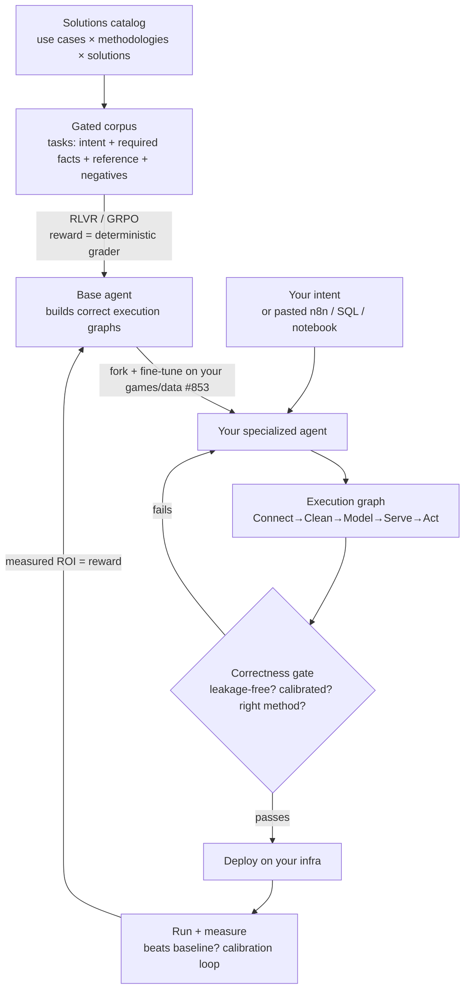

# From training corpus to correct production pipelines — how RLVR closes the loop

**The claim in one sentence:** the same deterministic gate that scores the training
corpus is the gate your production pipeline must pass to deploy — so an agent trained by
**RLVR** (reinforcement learning with *verifiable* rewards) to pass that gate produces
pipelines that are **correct by construction**, not correct by hope.

This document explains how the corpus you are generating today (zetta#866) turns into an
agent that makes your production AI pipelines and models actually work.

---

## 1. What "works effectively" means (and why AI projects fail)

Most AI projects don't fail because the model architecture is exotic. They fail because
the **pipeline around the model is wrong** in ways that don't show up until production:

- **Leakage** — a feature secretly encodes the outcome, so the model looks brilliant
  offline and useless live.
- **No calibration** — the scores aren't comparable to reality, so nobody can act on them.
- **The wrong methodology** — LLM pattern-matching over communications instead of a
  trained model over features (a common n8n churn workflow: a language model
  summarizing text, no feature vector, no trained model — which is why its risk numbers
  have no predictive power).
- **No measurement** — you can't tell whether it beat the previous approach.

So "works effectively" is a *checkable* property, not a vibe:

> A correct pipeline **connects** the data, engineers **leakage-free** features, trains
> the **right kind of model** with **explanations**, serves **calibrated** outputs, and
> keeps a **calibration loop** that measures itself against realized outcomes — and the
> resulting model **beats the baseline** on your data.

Every one of those is objectively verifiable. That verifiability is the whole game.

---

## 2. The corpus: verifiable *games*, not examples

Each training sample is not an "input → output" example. It is a **game** (`Task`) with a
built-in referee:

- an **intent** — the request, deliberately phrased many ways (terse, technical,
  business, vague), and sometimes with the user's **current state pasted in** (their n8n,
  SQL, or notebook) and a "make this better" ask;
- a **required end-state** — the *objectively checkable facts* of a correct solution
  (e.g. `leakage_free: true`, `model_kind: "gbdt"`, `explain: "shap"`, `calibrated: true`,
  `calibration_loop: true`);
- a **reference solution** that satisfies every required fact (it passes);
- **negative controls** — plausible-wrong solutions that each violate a required fact (the
  LLM-only approach, a leaky pipeline, a no-calibration pipeline) — they must **fail**.

These are grown from your **solutions catalog** (use cases × methodologies × solutions)
so the games cover the real portfolio, and every game is **gated before it enters the
corpus**: the reference must pass and the negatives must fail. If a game doesn't
*discriminate*, it's dropped. **Discrimination is the product, not the pass** — a corpus
that can't tell right from wrong teaches nothing.

---

## 3. The verifiable reward: a grader, not an opinion

This is the crux, and it's what makes RLVR different from ordinary fine-tuning or RLHF.

The reward is a **deterministic grader**. To score an agent's attempt, the environment:

1. runs the agent's tool calls, **building an execution graph**
   (`Connect → Clean → Model → Index → Serve → Act`);
2. reads the graph's **end-state** (does it connect? is the clean step leakage-free? is the
   model a gbdt with SHAP? is serving calibrated? is there a calibration loop?);
3. compares that to the task's **required facts** and returns pass/fail — a check that
   *runs*, not a learned reward model and not a human judgment.

Because the referee is a running check, an improvement is **demonstrated, not asserted**.
The reference churn solution scores 1.0; the LLM-only approach scores 0. That gap is
the training signal.

---

## 4. RLVR: learning to pass the gate

The base agent (an open-weights model — Qwen-class) learns by practice, using **GRPO**
(the blender-rl recipe, native in `MlxQwenModel::grpo_step`):

1. **Roll out** a group of attempts for a task — each a tool-call trajectory that builds a
   candidate graph.
2. **Grade** each with the deterministic grader → a reward per attempt.
3. **Group-relative advantage** — attempts better than the group average are pushed up,
   worse ones down (no separate value model needed).
4. **One policy-gradient step** nudges the agent toward the higher-reward (more-correct)
   trajectories.

Repeat over the whole corpus and the agent learns to reliably produce **correct**
pipelines from intent — and, because the corpus rotates phrasings and includes
current-state dumps, it learns to do so **however the request is worded** and to
**transform a pasted current approach** into a correct one. (We validated this loop end to
end on the real Qwen3-0.6B: it learns from the verifiable reward and stays stable across a
sustained run.)

---

## 5. The bridge to production: it's the *same* gate

Here is why training on this corpus makes **your** production pipeline work — not just the
training tasks:

The criteria the agent is trained to satisfy (leakage-free, calibrated, the right
methodology, explanations) are **the same criteria your production correctness gate
enforces before anything deploys**. Zetta is *correct-by-construction*: an execution graph
must pass the gate to be deployed. So the chain is:

> the agent was trained to **maximize a reward that is the gate** → therefore it produces
> **gate-passing graphs** → therefore your deployed pipeline is **correct by construction**.

The agent didn't memorize answers; it internalized *what correct looks like* as a
checkable property. When it builds your churn pipeline from your intent (or from your
dumped n8n), the same gate that graded its training re-checks the result, and the model
then has to **beat a baseline on your data** — measured, not claimed.

---

## 6. Specializing to your data: the fork

The base agent is general (trained on Orama's catalog). It becomes **yours** through the
per-customer fine-tune loop (zetta#853): fork the base checkpoint and continue the *same*
RLVR loop on **your** verifiable games, near **your** data, in **your** environment. For
churn, that means the churn game over your Snowflake/Postgres schema — the agent
specializes to your tables, your tools, your definition of correct — without your data
ever leaving your network.

---

## 7. The loop that keeps it working

Correctness at deploy time is necessary but not sufficient — the world drifts. The
**calibration loop** (a running score-versus-outcome record) becomes the
reward signal: production runs produce measured outcomes → the measured ROI is fed back as
training signal → the agent improves the solution over time. The reward the agent
ultimately chases is **your realized return**.

*The gate that scores training (left) is the gate that guards production (right) — the same
verifiable criteria, which is why a trained agent's pipelines are correct by construction.*

---

## 8. Concretely, for churn

- **Corpus sample #1** is your churn game: required end-state = connect + leakage-free
  features + **gbdt + SHAP** + calibrated serve + calibration loop; negative controls = the
  LLM-only approach (an n8n workflow that asks a model), a leaky pipeline, an uncalibrated one.
- **Training** teaches the agent that the LLM-only path *fails* and the gbdt+SHAP+calibrated
  path *passes*.
- **In production**, the agent takes your churn ask (or your pasted n8n) and builds the
  gbdt+SHAP+calibrated pipeline; the gate confirms it's leakage-free and calibrated; the
  model beats the baseline on your accounts; the calibration loop tracks it.
- The result is the improvement over the status quo, *by construction* — not "we hope the
  LLM did the right thing."

---

## Where this lives in the code

| Concept | Code |
|---|---|
| A game (task + required + reference + negatives) | `agent/task.hpp`, `agent/curriculum.hpp` (`churn_solution_case`) |
| The deterministic grader | `agent/grader.hpp` (`EndStateGrader`) |
| The gate (discrimination) | `agent/admission_gate.hpp` (`admit_corpus`) |
| The execution graph | `ir/execution_graph.hpp` (the 6 `StepKind`s) |
| RLVR / GRPO step | `compute::model::MlxQwenModel::grpo_step`, `agent::grpo_step` |
| Corpus generation (catalog → gated JSONL) | `scripts/build_catalog.py`, `scripts/gen_base_corpus.py` |
| Method + skill | the **rlvr-training-data** skill; blender-rl (an earlier RLVR prototype, not public) (the reference to reproduce) |

Related: [`training-data-runbook.md`](training-data-runbook.md) (operate the generators) ·
#866 (corpus) · #863 (base training) · #853 (the fork) · #862 (the churn demo).
