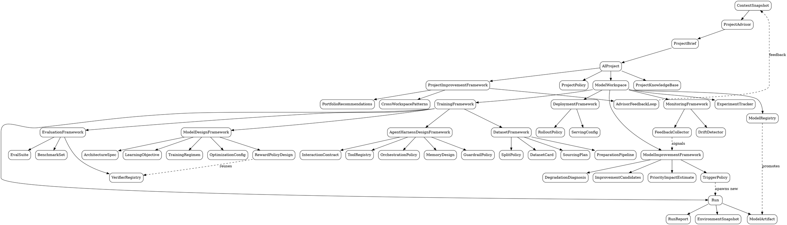
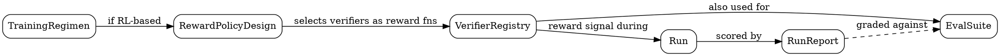
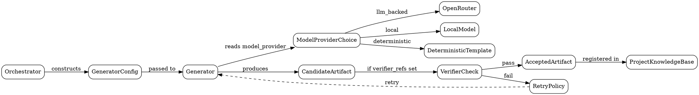

## Overview

This report specifies a complete, unambiguous abstraction hierarchy for a generative system whose purpose is to build other AI systems. It formalizes every container and artifact discussed — from the pre-project Context Snapshot through Model Workspaces, their design/training/evaluation frameworks, deployment, monitoring, and the improvement loops that feed back into project strategy — and introduces a **Generator Configuration** object that parameterizes how each artifact is produced, since generation may be stochastic, deterministic, or delegated to frontier models via OpenRouter.

The goal is a vocabulary precise enough that a generative model can be prompted with "generate a Dataset Framework for Model Workspace X" and know exactly what fields, parents, and children that entails, with no structural ambiguity.

## Design Principles

Three naming conventions are applied consistently across the entire system, and any new abstraction added later should follow them:

- **Containers end in `Framework`, `Workspace`, or `Project`** — these are specs/configs that group related sub-artifacts and can be regenerated or versioned as a unit.
- **Produced artifacts end in `Card`, `Report`, `Brief`, `Spec`, or `Snapshot`** — these are the outputs of a generation or execution step, immutable once created (new versions are new instances, not edits).
- **Cross-cutting services are not nested under the thing they observe** — trackers, registries, and improvement frameworks sit as siblings to what they monitor, because their value comes from comparing across multiple instances (e.g., across Runs, across Model Workspaces).

## Full Abstraction Hierarchy

The complete containment tree, in dependency order:

```
ContextSnapshot
 └─ ProjectAdvisor → ProjectBrief
      └─ AIProject
           ├─ ProjectPolicy
           ├─ ProjectKnowledgeBase (backed by LineageGraph)
           ├─ ProjectImprovementFramework
           │    ├─ CrossWorkspacePatterns
           │    ├─ PortfolioRecommendations
           │    └─ AdvisorFeedbackLoop → (updates ContextSnapshot / ProjectBrief)
           └─ ModelWorkspace[]
                ├─ ExperimentTracker
                ├─ ModelRegistry
                ├─ TrainingFramework (current + history)
                │    ├─ ModelDesignFramework
                │    │    ├─ ArchitectureSpec
                │    │    ├─ LearningObjective
                │    │    ├─ TrainingRegimen
                │    │    ├─ OptimizationConfig
                │    │    └─ RewardPolicyDesign (refs VerifierRegistry, when RL-based)
                │    ├─ AgentHarnessDesignFramework (optional)
                │    │    ├─ ToolRegistry
                │    │    ├─ OrchestrationPolicy
                │    │    ├─ MemoryDesign
                │    │    ├─ GuardrailPolicy
                │    │    └─ InteractionContract
                │    ├─ DatasetFramework
                │    │    ├─ SourcingPlan
                │    │    ├─ PreparationPipeline
                │    │    ├─ SplitPolicy
                │    │    └─ DatasetCard
                │    ├─ EvaluationFramework
                │    │    ├─ BenchmarkSet
                │    │    ├─ EvalSuite (→ TestCases)
                │    │    └─ VerifierRegistry
                │    └─ Run[] → ModelArtifact + RunReport + EnvironmentSnapshot
                ├─ DeploymentFramework
                │    ├─ RolloutPolicy
                │    └─ ServingConfig
                ├─ MonitoringFramework
                │    ├─ DriftDetector
                │    └─ FeedbackCollector
                └─ ModelImprovementFramework
                     ├─ DegradationDiagnosis
                     ├─ ImprovementCandidates
                     ├─ PriorityImpactEstimate
                     └─ TriggerPolicy → (spawns new Run / TrainingFramework version)
```

`ToolRegistry` (harness) and `VerifierRegistry` (eval) share a structural pattern — both are named collections of callable, schema-typed functions — and should inherit from a shared base type, `CallableRegistry`, so the generator treats "a set of typed invocable functions" as one reusable pattern rather than two separate ones.

## Component Reference

### Pre-Project Layer

| Abstraction | Type | Role |
|---|---|---|
| ContextSnapshot | Input data object | Captures the user's data shapes, goals, role, and company state at a point in time |
| ProjectAdvisor | Generator (model) | Reads a ContextSnapshot and produces a ProjectBrief |
| ProjectBrief | Artifact | Structured, promptable spec that seeds AIProject generation |

### Project Layer

| Abstraction | Type | Role |
|---|---|---|
| AIProject | Container | Top-level container holding one or more Model Workspaces |
| ProjectPolicy | Artifact | Cross-cutting constraints (compliance, cost, latency) inherited by all Model Workspaces |
| ProjectKnowledgeBase | Container | Introspectable state (reports, artifacts, lineage) queryable by a chat agent |
| ProjectImprovementFramework | Container | Detects cross-workspace patterns and recommends project-level strategy changes |

### Model Workspace Layer

`ModelWorkspace` is the per-model lifecycle container (previously drafted as "Workstream," renamed for clarity). Each AIProject holds one or more.

| Abstraction | Type | Role |
|---|---|---|
| ExperimentTracker | Service | Logs and compares all Runs across all TrainingFramework versions in this workspace |
| ModelRegistry | Service | Gates promotion of ModelArtifacts: candidate → staging → production |
| TrainingFramework | Container | The full methodology for training and testing this one model, versioned over time |
| DeploymentFramework | Container | Rollout strategy and serving configuration once a model is promoted |
| MonitoringFramework | Container | Sensors: drift detection and production feedback collection |
| ModelImprovementFramework | Container | Reasoner: diagnoses degradation and proposes retraining or redesign actions |

### Training Framework Sub-Components

| Abstraction | Type | Role |
|---|---|---|
| ModelDesignFramework | Container | Defines what the model is and how it learns: architecture, objective, regimen, optimizer, reward design |
| AgentHarnessDesignFramework | Container (optional) | Defines the agent wrapper: tools, orchestration loop, memory, guardrails, I/O contract — only present when the model acts as an agent |
| DatasetFramework | Container | Sourcing, cleaning, feature engineering, splitting, and analysis for this model's data |
| EvaluationFramework | Container | Benchmarks, custom evals, test cases, and the verifier functions used for both scoring and (optionally) RLVR rewards |
| Run | Instance | One concrete execution of a TrainingFramework version, producing a ModelArtifact, RunReport, and EnvironmentSnapshot |

## RLVR Integration Point

Reinforcement Learning with Verifiable Rewards is not a separate top-level abstraction — it is a **mode** declared inside `ModelDesignFramework.TrainingRegimen`. When selected, `RewardPolicyDesign` references specific entries in `EvaluationFramework.VerifierRegistry`, meaning the same verifier functions used to score an EvalSuite are reused as reward signals during training. This keeps a single source of truth for "what counts as correct" rather than duplicating verification logic between training and evaluation code paths.

## Generator Configuration Object

Every artifact and container above can be produced by a generator that is stochastic, deterministic, rule-based, or backed by a frontier model called via OpenRouter. To keep generation reproducible and swappable, a single configuration object should be passed to whichever generator produces any artifact in the tree.

### GeneratorConfig fields

| Field | Type | Purpose |
|---|---|---|
| `target_artifact_type` | enum | Which abstraction is being generated (e.g., `DatasetFramework`, `ModelArtifact`) |
| `mode` | enum: `deterministic` \| `stochastic` \| `llm_backed` \| `hybrid` | Governs whether output is reproducible template-fill, sampled, or model-generated |
| `model_provider` | enum: `none` \| `openrouter` \| `local` | Where the generation call is routed, when `mode` includes an LLM |
| `model_id` | string | Specific model identifier (e.g., an OpenRouter model slug), required if `model_provider != none` |
| `temperature` / `sampling_params` | struct | Controls stochasticity when `mode` is `stochastic` or `llm_backed` |
| `seed` | int (nullable) | Set for reproducible stochastic or LLM sampling; null means non-reproducible by design |
| `context_refs` | list of artifact IDs | Upstream artifacts the generator must read (e.g., ProjectBrief, DatasetCard) before producing output |
| `constraints_ref` | ProjectPolicy / TrainingFramework policy ID | Hard constraints the generated artifact must satisfy |
| `verifier_refs` | list of Verifier IDs (optional) | Verifiers to run against the generated artifact before accepting it |
| `retry_policy` | struct | Max retries, backoff, and fallback `model_id` if generation fails verification |
| `output_schema_ref` | schema ID | The exact schema the produced artifact must conform to |

### Why one shared config object

Using a single `GeneratorConfig` shape for every artifact type — rather than a bespoke config per Framework — means the orchestrator that walks the abstraction tree can call the same generation interface recursively: `generate(target_artifact_type, GeneratorConfig)` returns a validated artifact regardless of whether that artifact is a ProjectBrief, an ArchitectureSpec, or a full EvalSuite. Swapping `model_provider` from `local` to `openrouter`, or `mode` from `deterministic` to `llm_backed`, changes *how* an artifact is produced without changing *what* is produced or where it slots into the tree.

## Diagrams (Graphviz DOT)

### Full containment hierarchy



### RLVR integration detail



### Generator invocation flow



## Summary of Resolved Ambiguities

- The per-model container is named **ModelWorkspace**, replacing the earlier "Workstream" candidate, to avoid generic project-management connotations while staying consistent with `Model*` artifact naming.
- **ModelDesignFramework** and **AgentHarnessDesignFramework** are separated because architecture/learning-mechanics and agent-wrapper design (tools, memory, orchestration) are independent concerns; the latter is explicitly optional.
- **ExperimentTracker** and **ModelRegistry** sit at the ModelWorkspace level, not inside TrainingFramework, because their value comes from comparing across multiple TrainingFramework versions and Runs over time.
- **DeploymentFramework** and **MonitoringFramework** close the gap between "model trained" and "model in production," and **ModelImprovementFramework** / **ProjectImprovementFramework** close the loop back to retraining and project strategy respectively, at their appropriate scopes.
- RLVR is modeled as a **TrainingRegimen mode**, not a standalone abstraction, with its reward source pointing back at the same **VerifierRegistry** used for evaluation — eliminating duplicate verification logic.
- A single **GeneratorConfig** schema parameterizes all artifact generation regardless of stochasticity or backing model, so the orchestrator has one uniform generation interface across the entire tree.
</content>