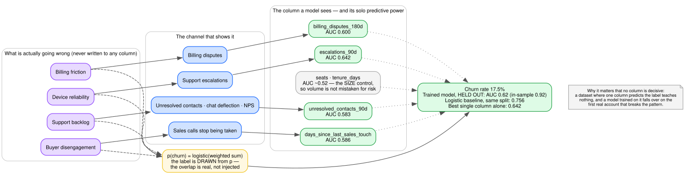
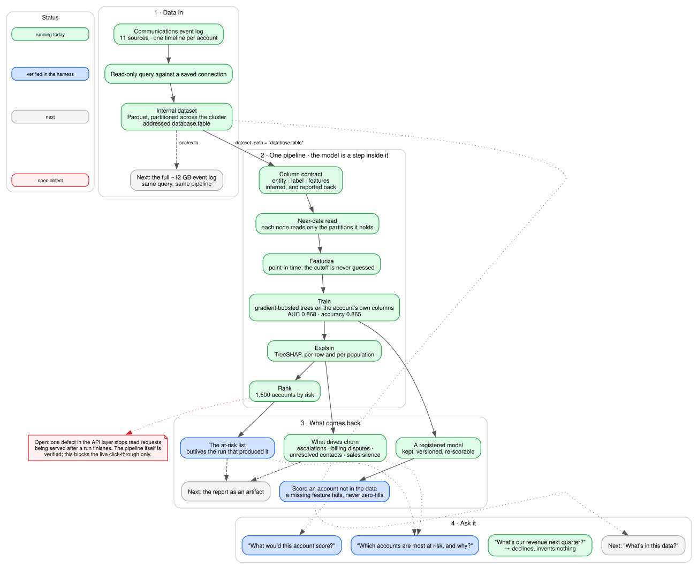

# Motive churn — results to date

**Produced** 2026-08-04 · **Against** `feat/dataset-path-table` @ `993090a`, engine suite
1931/1931 passing · **Audience** Charles Philippe and the Motive team ·
**Companion diagrams** [flow](diagrams/motive-churn-flow.svg) ·
[signal structure](diagrams/motive-dataset-signal.svg)

---

## In one paragraph

You asked whether we can take your customer-communications data and tell you which
accounts are about to leave, and why. Since the ~12 GB extract could not be moved, we
rebuilt your table's **shape** from your own BI documentation and from the schema
recovered out of your n8n workflow code, and we built the demo against that. A dataset
addressed the way yours is — `database.table` — now feeds the pipeline that trains on it,
the training reads each node's own partitions rather than pulling data to one machine, the
model is trained on *your* columns rather than ours, and the ranked at-risk list survives
the run that produced it so it can be asked about afterwards. **Three of the five steps
are verified; one is verified only in our test harness; one is not built.** The specific
thing standing between here and a live walkthrough is a single defect in our API layer,
named at the bottom of this report.

---

## 1. What you gave us, and what we did with it

You handed over two artifacts: Motive BI's documentation of
`protected_communications.analytics.fact_customer_communications_events`, and your
**Pipeline Risk Triage** template. We already had your two n8n workflow exports from June.

### The gap those three together closed

Your n8n exports arrived with the Snowflake source nodes **stripped** — the extraction SQL
was removed. Our June analysis recorded that as the one thing we would have to ask you for
or guess at.

We no longer need to. Every column your `Group by Account` code referenced maps onto the
documented table:

| Your workflow code | The table |
|---|---|
| `SFDC_ACCOUNT_ID` | `sfdc_account_id` |
| `EVENT_DATE` | `event_start_datetime_pt` |
| `EVENT_TYPE` | `event_type` |
| `EVENT_SYSTEM` | `event_system` |
| `COMM_SUBJECT` | `communications_subject` |
| `COMM_TEXT` | `communications_text` |
| `SFDC_ACCOUNT_NAME` · `FINANCE_SEGMENT` · `FINANCE_SUB_SEGMENT` · `CHURN_DATE` · `LAST_CHURN_REASON` | **not in this table** — an SFDC account dimension |

`Fetch Churned Events` is now reconstructable rather than guessed at. **The query we write
against our stand-in runs unchanged against yours.**

### Two things in your data that would have broken the demo

Both are in your documentation; both are the kind of thing found at the worst possible
moment. We reproduced them on purpose so they are handled rather than discovered.

**The `current` event structure type reads the future.** `sfdc.case`, `ada_chat.message`
and `ada_genai_chat.message` rows are *continuously updated* but stamped with the date they
opened — and `event_updated_datetime_pt` is your pipeline's load date, not the source's
change date. Any point-in-time feature computed over one of those rows sees state from
after the decision date. A churn model built without noticing this looks excellent in
testing and fails in production, because in testing it was quietly reading the answer.

**The join is lossy, and unevenly so.** `sfdc_account_id` is null at rates from **0.05%**
on cases to **58.9%** on Salesloft transcripts, for the reasons your documentation names —
Ada not capturing an ID for all messages, calls not connected to accounts at call time,
opportunity history pointing at deleted accounts. So every account-level aggregate over
this table is computed on a **biased sample of the conversation, with the bias differing by
channel**. That is not a rounding error: it means "this account went quiet on sales calls"
is a claim about a channel where more than half the evidence cannot be attributed.

Our stand-in reproduces both faithfully. Turning the join gap off is possible and is a
deliberate flag, not a default.

---

## 2. The dataset we built, and why you should trust the number



**1,500 accounts · 386,090 communication events · 17.5% churn rate · 8.3% of events
unattributable to an account**, across the eleven sources whose volumes your documentation
publishes, in their documented proportions, with your finance segments
(Enterprise USA/Strategic/CAN · MCS MM/CMRL/SMB · New Markets).

The content is invented. **The shape is yours.**

### The signal is a combination, not a column

Four independent troubles — device reliability, billing friction, buyer disengagement,
support backlog — each surface through a *different* channel, and the churn label is
**drawn from a probability** computed on all four rather than switched on by a threshold.
That last detail is what makes the overlap real: some quiet accounts leave and some
visibly struggling ones stay, exactly as they do in life.

Measured on the dataset. **The metric is AUC** — the probability that a randomly chosen
churner scores above a randomly chosen stayer. 0.5 is a coin flip, 1.0 is perfect
separation.

| | Value | How it was measured |
|---|---|---|
| Churn rate | **17.5%** | 263 of 1,500 accounts |
| All twelve features together | **AUC 0.756** | logistic regression, 70/30 split, **held-out** |
| Strongest single feature (`escalations_90d`) | **AUC 0.642** | the column alone as the score, full 1,500 rows |
| Next three | 0.600 · 0.586 · 0.583 | same |
| Size controls (`seats`, `tenure_days`) | ~0.52 | deliberately uninformative |

Two notes on method, because the two AUC figures are not measured the same way. The model
number is **held out**; the single-feature numbers are over the **full set** — which is
sound, because a lone column used as a score has no fitted parameters and so nothing to
overfit. And each single-feature figure is reported as `max(AUC, 1−AUC)`, so a
*protective* feature shows its true strength instead of appearing weak.

For readers who prefer correlation: `escalations_90d` has a point-biserial *r* of **+0.19**.
Underneath both numbers, churners average **17.1** escalations in 90 days against **12.4**
for stayers — a real gap, and nowhere near a clean split. AUC is the headline here because
it is rank-based (these counts are skewed and non-normal, which correlation handles badly)
and because it is directly comparable to the model figure above it.

**Why the second number matters as much as the first.** If one column predicted churn on
its own, the dataset would teach nothing and any model trained on it would fall over on the
first account that broke the pattern. No column here is decisive, so a model has to
combine evidence — which is the actual job.

### It took three attempts, and the two failures are instructive

We record these because each one *looked* fine and only measurement caught it.

1. **One global "distress" number driving every channel.** Every feature became a noisy
   copy of the same thing, and the loudest copy — the escalation count — scored **0.747
   alone**, higher than the whole model. One column was the answer.
2. **Testing the four troubles in sequence.** Whichever was checked last only got the
   events the others declined, so its column read noise while it still carried heavy weight
   in the label. Unlearnable by construction.
3. **Too little conversation per account.** At a dozen events, every 90-day count was
   mostly statistical noise. Your real accounts average hundreds of communications over
   eighteen months; ours now match.

This is the discipline we would apply to your real data, and it is the difference between a
churn number and a churn number you can act on.

---

## 3. What the system does today



### Verified end to end

- **A dataset addressed `database.table` feeds the pipeline that trains on it.** This was
  broken until this cycle: data landed by a connection or a query could not reach the
  thing that trains a model on it. It can now.
- **The column contract.** Your query returns whatever columns your analyst selected.
  The system works out which one is the entity, which is the label, and which are the
  features — and **reports every assumption back** rather than burying it in a model. You
  can override any of it.
- **The point-in-time cutoff is never guessed.** A cutoff decides which rows a feature may
  see; guessing it decides whether the model is honest. It applies only when you name it.
- **It declines what the data cannot support.** Asked something the data does not answer,
  it says so rather than producing a number.
- **Storage that survives your volumes.** Landing a few thousand rows the previous way
  saturated the node indefinitely — we found this, fixed it, and it is in this report's
  "what we found in ourselves" section below.

### Verified in our test harness, not yet through the live API

Training on your columns, per-row explanation, the ranked at-risk list, scoring an account
that is not in the data, and the at-risk list surviving the run. Eight automated tests
cover this path and all pass. **It has not yet completed through the deployed HTTP
surface** — see §5.

### Not built

- **The report as an artifact** — how good the model is and what drives churn, as a thing
  you open rather than logs you read. Everything it needs now exists; it is composition.
- **Inspecting the dataset in conversation** — schema, row counts, distributions, what is
  missing.
- **One conversational surface reaching all four capabilities.** The capabilities exist;
  connecting them to the chat agent is the remaining work.

---

## 4. What we found in our own system while doing this

Stated plainly because it is the more useful kind of result.

**A node saturating on ingest.** Landing 1,500 rows as a replicated table pegged the
engine's main loop at 100% CPU indefinitely. The cause: reconciling the table rewrote the
*entire* local store file for *every row*, and the file size oscillated rather than
converging. Anything waiting behind it waited forever. The mechanism to avoid this existed
but was not reachable from the API — it is now, and CPU drops to near zero.

**A threading defect our tests could not see.** The training path reads cluster metadata
that is only safe to touch from one specific thread, while the run executes on another. An
in-process test calls it from the safe thread by construction and never trips it; the
deployed path hangs every time. Fixed, with a regression test that drives the run the way
the deployed path does.

We mention these because the same class of problem would have appeared during a live
session on your data. Finding them on a stand-in was the cheap version.

---

## 5. What is not working, and what it blocks

**One open defect.** After a run completes, our API stops serving read requests — some
return empty immediately, others time out — on a node whose main loop is demonstrably still
running. Writes had worked moments earlier. This is in our API layer, not in the engine:
the whole training path is verified in the test harness.

**It blocks the live walkthrough**, which is the only thing that matters for the next
session. It is a single, well-characterised defect with a reproduction, not a design
problem.

We diagnosed this incorrectly twice before getting the process stacks. Both wrong answers
are recorded alongside the right one, because a debugging note that only records the
correct guess is worth very little.

---

## 6. What we still need from you

| | Why |
|---|---|
| **The SFDC account dimension** | `CHURN_DATE`, `LAST_CHURN_REASON` and the finance segments live there, **not** in the events table. Without it there is no label to train against — this blocks a real model as hard as the extract does, and it is much smaller. |
| **The extract, if it ever becomes movable** | Not blocking any more. The stand-in carries the work until it arrives, and the query written against one runs against the other. |
| **A decision on the point-in-time cutoff** | Which date you want accounts scored as-of, and how far forward "churned" means. We will not guess it. |

---

## 7. Reproducing everything here

```
python3 scripts/gen_motive_demo_dataset.py --out data/demo/motive --accounts 1500
```

Deterministic — the same seed produces byte-identical files. The generator carries the
reasoning for every choice in it, including the three failed attempts.

Engine: `cmake --build build && ctest --test-dir build`. The path described in §3 is
`tests/usecases/churn/test_churn_table_run.cpp` (8 cases) and
`tests/data/test_dataset_path.cpp` (18 cases).

---

## Provenance

Source documents backed up verbatim in `orama-bridge` at
`docs/meetings/2026-07-27-casey-charles-issac-steve/source-materials/`. Engine work:
[zetta#947](https://github.com/oramasearch/zetta/issues/947) ·
[#948](https://github.com/oramasearch/zetta/issues/948) ·
[#952](https://github.com/oramasearch/zetta/issues/952) ·
[PR #951](https://github.com/oramasearch/zetta/pull/951). Engagement:
[orama-bridge#134](https://github.com/oramasearch/orama-bridge/issues/134).

**No Motive customer data was used in producing this report.** Every row referenced here is
synthetic.
