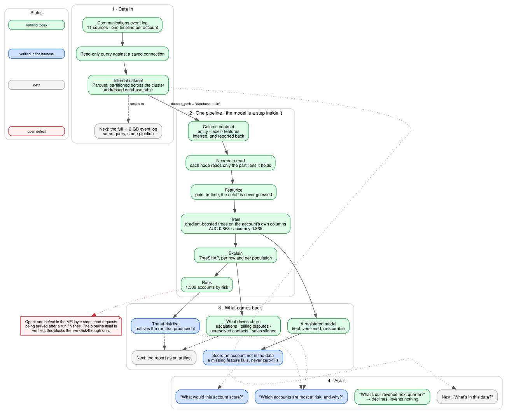

# Churn run report

**Model** `354c6564-d174-4904-8d06-b793e9b789a0` · **2026-08-04**

*Generated from the run's facts artifact by the prompt in
[`docs/pipeline/run-report-prompt.md`](../../pipeline/run-report-prompt.md). Every number
below appears in that artifact — nothing here was computed while writing.*

## What this run produced

A churn model trained on 15,000 accounts drawn from 3,870,209 communication events, using
13 features. 10,500 accounts were used for training and 4,500 held back. The run produced a
registered model, a ranked list of accounts by churn risk, and the driver weights below. The
churn rate across the dataset is 18.4%.

## How good the model is

**Held out: AUC 0.726**, measured on the 4,500 accounts the model was not trained on. That
is the figure that describes how it behaves on an account it has not seen.

**In sample: AUC 0.770**, over the 10,500 accounts it trained on. Accuracy 0.823, log-loss
0.408.

**Accuracy needs its base rate beside it.** 18.4% of accounts churn, so predicting that no
account ever churns would be 81.6% accurate. The model's 82.3% is measured on the rows it
trained on and sits barely above that constant answer, which is what accuracy does on any
problem where one outcome is uncommon. It is reported because the training job produces it,
not because it is the figure to judge the model by.

**The gap between them is 0.04.** A model that scores far higher on its own training data
than on new accounts has memorised those accounts rather than learned from them, and it
degrades sharply on anything new. A gap this small means the training-set score is not
carrying the result.

## What the pipeline did

Connect, featurize, train, explain, rank. The model is a step inside the pipeline rather than
something wrapped around it, so training happened because the pipeline ran.

## What drives the outcome

Driver weights from the trained model, strongest first. A weight says how much a column
moved predictions across the population — it does not say the column *causes* churn.

| Driver | Weight | What the column measures |
|---|---|---|
| `escalations_90d` | 0.527 | support escalations in the last 90 days |
| `unresolved_contacts_90d` | 0.389 | contacts in the last 90 days that went unanswered |
| `billing_disputes_180d` | 0.344 | billing disputes in the last 180 days |
| `seats` | 0.214 | fleet size |
| `support_events_90d` | 0.191 | all support events in the last 90 days |
| `days_since_last_sales_touch` | 0.163 | days since the last sales contact |
| `nps_score` | 0.091 | most recent NPS response |
| `escalation_trend` | 0.085 | last 90 days of escalations against the prior 90 |
| `nps_is_detractor` | 0.060 | whether the NPS response was a detractor score |
| `sales_touch_trend` | 0.022 | last 90 days of sales contact against the prior 90 |
| `distinct_channels_90d` | 0.018 | how many channels the account was active on |
| `tenure_days` | 0.015 | days since the account started |
| `chat_deflection_failures_90d` | 0.008 | in-app chat sessions that did not resolve |

**No single driver dominates.** The strongest weight is 0.527 and the next two are 0.389 and
0.344 — the top three are the same order of magnitude, and the model's output depends on
their combination rather than on any one of them.

## Who is most at risk

The twenty highest-risk accounts, by the model's score. Evidence columns are the three
strongest drivers, shown at their values for that account.

| Rank | Account key | Risk | Escalations 90d | Unresolved 90d | Billing disputes 180d |
|---|---|---|---|---|---|
| 1 | 8336 | 0.766 | 19 | 26 | 37 |
| 2 | 4846 | 0.759 | 22 | 22 | 42 |
| 3 | 2795 | 0.749 | 33 | 24 | 20 |
| 4 | 11376 | 0.747 | 23 | 26 | 40 |
| 5 | 5312 | 0.740 | 20 | 26 | 36 |
| 6 | 3980 | 0.740 | 22 | 33 | 37 |
| 7 | 13566 | 0.734 | 22 | 26 | 22 |
| 8 | 1011 | 0.719 | 21 | 37 | 24 |
| 9 | 14711 | 0.717 | 20 | 29 | 42 |
| 10 | 13214 | 0.713 | 23 | 28 | 41 |

Accounts are identified by their entity key, which is the integer column the model was given.
Business names are not part of this run's facts and are not supplied here.

**Read the evidence columns across each other, not down any one of them.** An account near the
top on all three is in a different situation from one carried by a single large number, and
the second is the more likely false positive. The evidence is shown so that judgment stays
with the person working the list rather than with the score.

**The list has a head, and that is what makes it worth working.** The top account scores 0.766
and the twentieth scores 0.709, so the first few names are meaningfully more exposed rather
than simply first in an arbitrary order. None of them is near certainty: these are the highest
scores in a population of 15,000, some accounts at the top will renew, and some further down
will leave. A ranked list is a way to spend attention where it pays best, not a prediction
about any one customer.

## What to check before acting on this

- **The risk values rank; they are not calibrated probabilities.** Probability calibration
  was not enabled for this run, so 0.766 means "highest in this population", not "a 76.6%
  chance of churning".
- **The held-out figure is the one to quote.** The in-sample figure is included so the gap
  can be read, not as a performance claim.
- **A driver is a weight, not a cause.** `escalations_90d` carrying the most weight means the
  model leans on it most; it does not establish that escalations cause accounts to leave.
- **`seats` carries real weight while barely separating churners on its own.** The model is
  reading counts relative to account size rather than treating size as risk.
- **The label horizon and scoring date are properties of the dataset**, and are not part of
  this run's facts. Check them against what the question needs before using this list.
